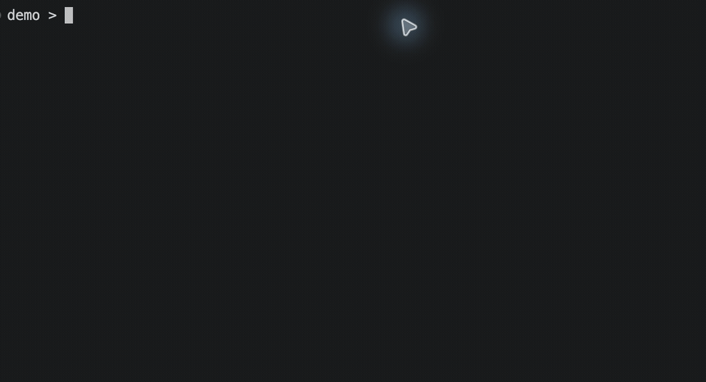

# RepoPilot

**Turn a scoped task into reviewed, verified changes—with an audit trail.**

Set up Codex specialists, understand a repository from evidence, and move from a plan to reviewed
changes in an isolated worktree. RepoPilot brings policy, checks, and recoverable run history to your
terminal so each project can follow the same process.

[Getting started](#getting-started) · [Features](#features) · [Documentation](#documentation) · [Contributing](#development-and-contributing)



**v0.3.0 · Developer preview.** The CLI works locally; model-backed development needs Codex or Ollama.
The dashboard is a preview shell. Review generated changes and use target-project checks only in
repositories you trust.

## Getting started

### Install from npm

Requires **Node.js 22–25 and Git** on macOS or Linux. The npm package is named `repilot`;
`repilot` and `repopilot` are command aliases.

```bash
npm install -g repilot
repopilot --license
# Only if you agree to EULA v1.0:
export REPOPILOT_ACCEPT_EULA=1
repopilot version
repopilot doctor
```

Read the [npm package guide](docs/product/NPM_README.md) for usage, upgrades, and uninstall instructions.

### Install from source

Requires **Node.js 22, pnpm 11, and Git**.

```bash
git clone https://github.com/steveleecode/RepoPilot.git
cd RepoPilot
cat docs/legal/EULA.txt
# Only if you agree to EULA v1.0 (including for source builds):
export REPOPILOT_ACCEPT_EULA=1
pnpm install --frozen-lockfile
pnpm build
pnpm repopilot doctor
```

For maintainers, the [npm release workflow](docs/releases/NPM_WORKFLOW.md) builds a selected Git ref,
validates it on Linux/macOS, and publishes through npm trusted publishing after an explicit manual
release request.

Run commands from this checkout with `pnpm repopilot`. To create a standalone CLI archive:

```bash
pnpm release:build
(cd release-artifacts && shasum -a 256 -c repopilot-0.3.0.sha256)
npm install -g ./release-artifacts/repopilot-0.3.0.tgz
repopilot --license
# Only if you agree to EULA v1.0:
export REPOPILOT_ACCEPT_EULA=1
repopilot version
```

The release builder smoke-tests isolated global installation and removal locally. Existing release
CI runs on Node 22 Linux; the [npm release action](.github/workflows/publish-npm.yml) adds Linux/macOS
validation and explicitly requested, tokenless npm publishing.
Hosted CI results must pass before release; Windows is currently unvalidated
and unsupported for standalone release installation. The archive contains the `repilot` npm package;
its local filename retains the RepoPilot name for compatibility with existing CI artifact paths.

The archive bundles the CLI, context brokers, EULA, and [third-party notices](docs/legal/THIRD_PARTY_NOTICES.txt).
Packaged commands require explicit EULA acceptance, except `repopilot --license`. Installation without
acceptance skips shell setup. After acceptance, run `repopilot completion install zsh` to enable it.
Global zsh installation with acceptance attempts to enable completion;
open a new terminal afterward. Set `REPOPILOT_SKIP_COMPLETION_SETUP=1` before installation to opt out.
See [completion setup and removal](docs/product/CLI_REFERENCE.md#zsh-command-menus-and-completion).

### Your first useful workflow

No model credentials are needed to scan a project, generate specialist guidance, or prepare a task prompt.
Replace `/path/to/project` with an existing local repository:

```bash
pnpm repopilot scan --repo /path/to/project
pnpm repopilot setup --repo /path/to/project
pnpm repopilot codex prompt "Add a search filter" --repo /path/to/project
```

`scan` reports detected languages, manifests, scripts, tooling, and evidence counts without running
project scripts. `setup` guides you through repository policy and Codex specialist selection, preserves
existing files, and offers optional hosted-provider setup. Skip key entry to stay credential-free.
Setup writes policy and guidance files in the target project. Start Codex in that repository and paste
the generated prompt to begin the structured task workflow.

After installing the standalone CLI, enable described menus in your current **zsh** session:

```zsh
eval "$(repopilot completion zsh --auto-menu)"
```

Type `repopilot `, browse with arrow keys, and select a command.
Use `repopilot help setup` or `repopilot help workflow` for focused help.

## Features

| Capability                  | What it gives you                                                                                                                                                                                         |
| --------------------------- | --------------------------------------------------------------------------------------------------------------------------------------------------------------------------------------------------------- |
| **Repository evidence**     | Bounded metadata analysis with evidence for detected facts, including TypeScript, JavaScript, Python, Rust, and Go signals. Detection does not imply support for every language's build tooling.          |
| **Codex specialist setup**  | Select researcher, developer, tester, reviewer, security, and optional specialist roles. Generate agent configuration and an eight-stage task prompt.                                                     |
| **Terminal discovery**      | Real zsh completion with command descriptions, flags, value suggestions, and optional automatic menus.                                                                                                    |
| **Supervised development**  | Codex or Ollama planning, bounded proposals, isolated-worktree apply, explicit validation, repair limits, and independent review. The supervised runner currently accepts one scoped implementation task. |
| **Recoverable runs**        | Local append-only journals retain plans, artifacts, approvals, and delivery state for inspection and resume.                                                                                              |
| **Deterministic policy**    | Repository configuration controls approvals, validation, commits, pushes, and parallel-safety rules. CLI flags cannot bypass policy.                                                                      |
| **Optional read-only chat** | Groq by default, or Gemini, with a project-local key. Chat does not implement changes; Gemini can optionally tailor setup templates.                                                                      |

Repeated setup and ad hoc handoffs make AI coding difficult to review. RepoPilot records the workflow
and its evidence, keeps proposals separate from applied files, and makes validation and delivery
explicit. Specialist setup supplies instructions for Codex; it does not itself launch a parallel agent team.

## How it works

1. **Discover and configure.** Scan metadata, select specialists, and review `.repopilot/config.yaml`.
2. **Plan and propose.** Use Codex or Ollama to create a plan and bounded file proposals.
3. **Inspect and apply.** Review artifacts before applying validated proposals in an isolated Git worktree.
4. **Verify and review.** Explicitly authorize project checks; supervised runs add bounded repair and independent review.
5. **Deliver under policy.** Keep results for review, commit locally, or explicitly request a permitted push.

After [installing and authenticating Codex or configuring Ollama](docs/product/CLI_REFERENCE.md#providers),
the standalone CLI supports this inspectable sequence:

```bash
repopilot providers codex login
repopilot plan "Improve parser coverage" --provider codex --repo /path/to/project
repopilot propose <run-id> --repo /path/to/project
repopilot inspect <run-id> --repo /path/to/project
repopilot apply <run-id> --approve --repo /path/to/project
repopilot verify <run-id> --execute-checks --repo /path/to/project
```

Use the run ID returned by `plan`. Fresh worktrees need their own project dependencies before checks;
see the [development workflow](docs/product/CLI_REFERENCE.md#local-development-workflow-phases-810).
For supervised implementation and recovery, see [run status](docs/product/CLI_REFERENCE.md#run-status)
and [resume](docs/product/CLI_REFERENCE.md#resume-run).

## Trust and control

Analysis treats repository content as untrusted data and does not execute repository scripts or load
repository source into the RepoPilot process. Development source context is read through separate,
bounded brokers. `--execute-checks` permits target tooling to run: **this is not an OS sandbox**.

RepoPilot adds no telemetry or GitHub authentication. Codex uses its own authentication and sends
bounded context to OpenAI; Ollama uses a configured loopback endpoint. Optional Groq/Gemini chat
sends messages and optional repository metadata to the selected provider. Keys stay in the project's
ignored `.repopilot/.env`; optional tailoring sends selected templates and a description.

Commits and pushes require policy authorization and any configured approvals. Review-only delivery
is the default for supervised runs; automatic commit/push delivery is an explicit option. RepoPilot
does not force-push, create pull requests, merge, or deploy.

## Documentation

| Start here                                                              | Purpose                                                                    |
| ----------------------------------------------------------------------- | -------------------------------------------------------------------------- |
| [CLI reference](docs/product/CLI_REFERENCE.md)                          | Setup, everyday commands, provider configuration, completion, and recovery |
| [Execution policy](docs/product/EXECUTION_POLICY.md)                    | Permissions, approval gates, presets, and validation requirements          |
| [Release notes](docs/releases/v0.3.0.md)                                | Preview limitations, archive installation, upgrade, and uninstall          |
| [Documentation index](docs/README.md)                                   | User guides, contributor references, and design documents                  |
| [Capability audit](docs/product/README_AUDIT.md)                        | Source evidence behind this README and verification results                |
| [Feature roadmap](docs/product/FEATURE_ROADMAP.md)                      | Completed increments and remaining priorities                              |
| [System overview](docs/architecture/SYSTEM_OVERVIEW.md)                 | Package boundaries and architecture                                        |
| [Package reference](docs/architecture/PACKAGE_REFERENCE.md)             | Internal contracts and package responsibilities                            |
| [Validation and security](docs/architecture/VALIDATION_AND_SECURITY.md) | Trust boundaries and execution limits                                      |

## Development and contributing

Use Node.js 22 and pnpm 11. After cloning and installing dependencies as above:

```bash
pnpm test       # Unit and integration tests
pnpm build      # All workspace packages and the dashboard
pnpm check      # Formatting, lint, types, tests, and build
pnpm test:e2e   # Playwright dashboard smoke tests (requires browser binaries)
```

Read [AGENTS.md](AGENTS.md) before changing repository analysis or execution behavior. Keep contracts
in their owning packages and attach evidence to detected facts. Run `pnpm check` before submitting
changes. The [documentation index](docs/README.md#for-contributors) links architecture and decisions.

[Source](https://github.com/steveleecode/RepoPilot) · [Issues](https://github.com/steveleecode/RepoPilot/issues)

**License:** proprietary, with publicly visible source. See the
[RepoPilot EULA](docs/legal/EULA.txt), version 1.0, effective November 4, 2026. Personal and internal
business use are permitted under its terms; redistribution, reuse in other products, and hosted
services require separate permission. GitHub platform rights and third-party licenses remain
unaffected. Public source availability does not make RepoPilot open source.
